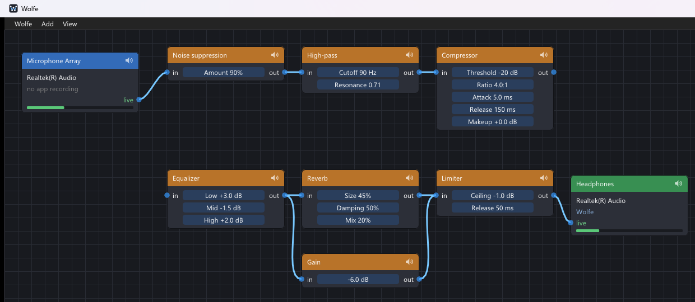
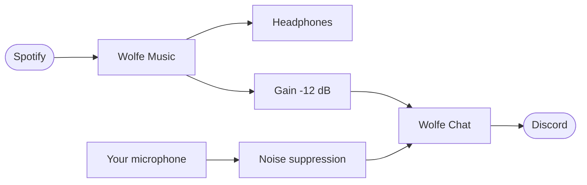

  

<h1 align="center">Wolfe</h1>

  <b>An audio patchbay for Windows.</b> 
  Make speakers and microphones of your own, and wire them to your real ones through effects.

  
  
  
  
  
  

  <a href="#install">Install</a> ·
  <a href="#quick-start">Quick start</a> ·
  <a href="#effects">Effects</a> ·
  <a href="#the-window">The window</a> ·
  <a href="#building-from-source">Build</a>

  

What qpwgraph or Carla give you on Linux, built on what Windows offers.
Microphones, speakers and effects are boxes, and you decide what goes where.

Wolfe is one big node of its own. It has playback and recording devices of
its own, which Windows lists like any sound card. Which applications play on
them or record from them is chosen in Windows' settings; inside Wolfe they
are boxes like your microphone and your headphones, and you link them as you
like.

## Features

- 🔊 **Devices of its own.** Wolfe speakers and Wolfe microphones appear in
  Windows like any sound card, and any application can use them. No virtual
  cable to install: they are USB sound cards, attached through
  [usbip-win2](https://github.com/vadimgrn/usbip-win2), whose driver is
  signed by Microsoft.
- 🎛️ **A real patchbay.** Link microphones, speakers and Wolfe's devices as
  you like: one source to many places, many sources into one, effects in
  between. Links that would loop are refused.
- ✨ **15 effects.** Noise suppression with RNNoise (as in Mumble), with a
  voice gate that keeps typing out; compressor, limiter, noise gate, filters,
  equalizer, delay, reverb, chorus and more. Every box explains itself.
- 🔀 **Routing.** Mute a single link, switch between sources with a
  Selector, split or join with a Junction.
- 📦 **Take it with you.** Export the graph to a file and import it on
  another computer: its devices are found there by name.
- ⚡ **Low latency.** 10 ms cycles; an application on a Wolfe speaker reaches
  your headphones in 35-40 ms. Every device's clock is followed, so devices
  do not drift apart over time.
- 🧲 **Applications come back.** When Wolfe starts again, applications you gave
  its devices are moved back to them; those you put back on the default device
  stay there.
- 🪶 **Out of the way.** Lives in the notification area, starts with Windows,
  saves the graph by itself.
- 🆓 **Free software**, under the GNU GPL 3.0.

## Install

Download **`Wolfe-Setup-<version>.exe`** from the
[latest release](https://github.com/pentecoste/wolfe/releases/latest) and run
it. It needs Windows 10 (1903 or later) or 11, 64-bit.

Setup asks for an administrator once, installs Wolfe, and installs
[usbip-win2](https://github.com/vadimgrn/usbip-win2) too when it is missing
or older than the copy it carries (its own, unmodified installer, run
silently: only the client and its drivers). While usbip-win2's driver goes
in, Windows restarts the USB controllers, so USB devices stop for a moment.

> [!NOTE]
> The program is not signed: Windows SmartScreen may warn about it the first
> time. Choose "More info", then "Run anyway".

More about setup and uninstalling

- "Start Wolfe with Windows" is offered, and ticked: Wolfe's devices exist
  only while it runs. The same setting is in Wolfe's own menu.
- Running setup again updates Wolfe; a running Wolfe is asked to exit first.
- The folder chosen must be empty or new (or an earlier Wolfe's): setup
  would replace what is there, and uninstalling would delete it.
- Uninstalling (Installed apps) removes Wolfe and its "start with Windows"
  entry. Your graph and settings in `%APPDATA%\Wolfe` stay, and so does
  usbip-win2, which has its own entry in Installed apps.
- Wolfe offers its devices over USB/IP on 127.0.0.1 (port 3241) and has
  usbip-win2 attach them; using them needs no administrator. Another USB/IP
  server on the machine (usbipd-win) is fine: it uses port 3240. Without
  usbip-win2 everything else works, but Wolfe has no devices of its own.

## Quick start

Say you want your friends on Discord to hear your voice, cleaned up, with
Spotify quietly behind it, while you hear Spotify in your headphones:

1. In Wolfe, press **Ctrl+A**, type `wolfe speaker` and Enter, and call it
   *Wolfe Music*. Do the same with `wolfe microphone`, *Wolfe Chat*.
2. In Windows, give Spotify the output *Wolfe Music* (Settings > System >
   Sound > Volume mixer). In Discord, choose *Wolfe Chat* as the microphone.
3. Back in Wolfe, add your headphones, your microphone, a Gain and a Noise
   suppression with **Ctrl+A**, and drag links between the pins as in the
   picture above. Drag the Gain's value down to -12 dB.

That's it: Wolfe remembers the graph and builds it again every time it starts.

> [!TIP]
> The first time Wolfe opens, its welcome window offers to **build this
> example** for you, with your default microphone and headphones. It is in
> Help > Getting started too.

## Effects

| effect      | what it does                                                        | settings (in the file)                                   |
|-------------|---------------------------------------------------------------------|----------------------------------------------------------|
| Junction    | passes the sound on as it is: a point to split or join links, or to mute one branch | none                                     |
| Selector    | lets through one of the sources linked into it, the one clicked in the box; the others are silent | `selected` (the id of that source's node) |
| Gain        | louder or quieter, -60 dB (silent) to +24 dB                        | `gain_db`                                                |
| Pan         | toward the left (-100) or the right (+100): the other side gets quieter | `pan`                                                 |
| Compressor  | above the threshold the level rises only 1/ratio as much: evens out a voice | `threshold_db`, `ratio`, `attack_ms`, `release_ms`, `makeup_db` |
| Limiter     | never louder than the ceiling: protects ears and recordings         | `ceiling_db`, `release_ms`                               |
| Noise gate  | silent while the sound stays under the threshold: hides a microphone's hiss between words | `threshold_db`, `release_ms`        |
| Noise suppression | RNNoise, as in Mumble: a small neural network tells voice from steady noise (fans, hum, traffic) and keeps the voice, also while you speak. The original can be mixed back in. The voice gate mutes what RNNoise is not sure enough is a voice, which keeps out keyboard clicks and other short noises between words (0 turns it off) | `amount`, `voice_gate` (percent) |
| High-pass   | lets through what is above the cutoff, 12 dB per octave: takes away rumble and hum | `cutoff_hz`, `q` (resonance)              |
| Low-pass    | lets through what is below the cutoff, 12 dB per octave: takes away hiss and harshness | `cutoff_hz`, `q`                      |
| Equalizer   | lows (below 150 Hz), mids (around 1 kHz) and highs (above 5 kHz) up or down | `low_db`, `mid_db`, `high_db`                    |
| Delay       | echoes: one every `time_ms`, each one `feedback` percent as loud as the one before | `time_ms`, `feedback`, `mix` (percent)    |
| Reverb      | a room around the sound (Freeverb)                                  | `size`, `damping`, `mix` (percent)                       |
| Chorus      | copies slightly out of time that swing: a thicker, shimmering sound | `rate_hz`, `depth_ms`, `mix`                             |
| Tremolo     | the volume going down and up again, over and over                   | `rate_hz`, `depth`                                       |
| Distortion  | rounds off the peaks: warm at low drive, fuzzy at high drive        | `drive_db`, `mix`                                        |
| Bitcrusher  | fewer levels and fewer samples a second: lo-fi, old game consoles   | `bits`, `rate_hz`                                        |

`mix` ("wet" in the box) is how much of the processed sound replaces the
original: at 0 the effect changes nothing, at 100 only the processed sound is
left. Levels are in dB below full scale: 0 dB is the loudest digital audio can
be. Apart from the echoes that Delay, Reverb and Chorus
are for, effects add no delay to the audio, except Noise suppression: RNNoise
hands back each 10 ms one block late, so it adds 10 ms.

## The window

The canvas shows only what you put on it. **Ctrl+A** opens a search for
something to add: type part of its name, and Enter adds the one highlighted
(Up and Down choose another). The Add menu, and a right click on the canvas,
offer the search, the effects, Wolfe's own devices, and the computer's
microphones and speakers that are not on the canvas yet. Every box has a
**?** in its title: hover it to read what the box is for and what its
settings do.

| box              | what it is                                                                          | pin   |
|------------------|-------------------------------------------------------------------------------------|-------|
| Microphone       | a recording device of the computer (a microphone, the far end of a virtual cable)  | out   |
| Wolfe speaker    | a playback device of Wolfe's own: what applications play on it comes into Wolfe     | out   |
| an effect        | changes what is linked into it and passes it on (see [Effects](#effects))           | both  |
| Speaker          | a playback device of the computer (headphones, speakers)                           | in    |
| Wolfe microphone | a recording device of Wolfe's own: applications that record from it hear what is linked into it; its out pin passes the same sound on (link it to your headphones to hear what they hear) | both |

Wolfe takes audio from microphones and from its own speakers, and sends it to
speakers and to its own microphones. It does not show applications and does
not move them: give an application one of Wolfe's devices in Windows'
settings (Settings > System > Sound > Volume mixer) or in the application's
own, and link that device in Wolfe. Windows shows Wolfe's microphones as line
inputs, so that it does not apply its voice processing to them.

| to…                         | do this                                                              |
|-----------------------------|----------------------------------------------------------------------|
| add something               | **Ctrl+A**, the Add menu, or right-click the canvas                  |
| link two boxes              | drag from a pin to another pin                                       |
| move a link                 | drag the link itself: the nearer end comes off and goes where you let go |
| remove a link               | pull it away and let go over nothing, **Ctrl+click** it, or click it and press **Delete** |
| change a setting            | drag its value left or right (**Shift**: faster, **Alt**: finer); double-click to type one |
| mute a box                  | click the loudspeaker at the right of its title                      |
| mute a link                 | right-click it, Mute this link                                       |
| switch a Selector           | click one of the sources listed in it                                |
| learn what a box does       | hover the **?** in its title                                         |
| open a box's or link's menu | right-click it                                                       |
| remove what is selected     | **Delete**                                                           |
| move the view               | middle button, or **Alt** + drag                                     |
| zoom                        | mouse wheel, **Ctrl +** / **Ctrl -**, the View menu; **Ctrl+0** for the actual size |

- A pin takes any number of links: links into the same box are added
  together, and a box can feed any number of others. A link that would bring
  audio back to where it came from is refused, also through the two ends of a
  virtual cable.
- An effect's menu puts its settings back as they started.
- Muting works inside Wolfe: what comes out of a microphone, a Wolfe speaker
  or an effect becomes silence, and a speaker or a Wolfe microphone is given
  silence. The device itself, and its mute in Windows, are not touched. A
  muted box's loudspeaker is red and crossed out. A link that carries no
  sound is grey: after a muted box, a muted link, or anywhere further along;
  a link muted itself is dull red. Muting is kept in the file
  (`"muted": true`).
- Zooming goes from 39% to 214%, around the mouse, and changes only the
  view, not the positions kept in the file.

Removing one of Wolfe's devices is asked first: Windows loses it, and sends
the applications that were given it back to the default device. A new device
with the same name is a new device to Windows. Wolfe's devices exist while
Wolfe runs, whether or not anything is linked to them; a device of the
computer is only opened while something is linked to it.

### What a box says

`live` when Wolfe is using it, `not linked` when nothing is linked to it,
`not plugged in` when the device is missing (the box stays, and works again
when the device comes back). One of Wolfe's devices is `ready` once Windows
has it, and a microphone of Wolfe's is `in use` while an application records
from it.

Under a device's name are the applications that are playing on it right now
(a recording device: recording from it), by the name the program gives
itself. Hovering the box lists also those that only have a silent stream open
there, as many programs keep one. The Wolfe menu can leave the list out of
the boxes; the tooltip always has it. Windows' own sounds and Wolfe itself
are not listed. A program that listens to what is played on a device (a
screen recorder, a game streaming host) is listed as playing there: Windows
does not tell the two apart.

The bar is the level, with its number in dB after it: for a device as
Windows measures it (a recording device only has a level while something
records from it), for an effect what comes out of it. The Compressor, Limiter
and Noise gate show what goes in instead, with their threshold marked by a
line: what goes past the line is what they act on. A box with an orange outline is
linked but not working: its text says why. When a link cannot be made, the
reason appears next to the mouse.

### When Wolfe is closed, and comes back

While Wolfe is not running its devices are gone, and Windows plays the
applications that were given them on the default device. Exiting is
therefore asked first (Exit in the Wolfe menu or on the icon, or closing the
window when Wolfe is not kept running).

Windows keeps remembering which device each application was given, also
while that device is missing; an application put back on the default device
on purpose has no device of its own any more. So when Wolfe's devices come
back (Wolfe starts again, or starts after the applications), Wolfe looks for
applications that were given one of them but are playing elsewhere, and
moves them back, within a couple of seconds, once each; those put on the
default device on purpose stay where they are. The log says which were
moved. This uses the interface Windows' own settings use, which is not
documented: on Windows older than 10 21H2 it is not there, and those
applications go back to Wolfe's devices only when they open their audio
again (usually when they are restarted).

### Where things are kept

The graph is saved by itself in `%APPDATA%\Wolfe\graph.json` and loaded again
at the next start. Closing the window leaves Wolfe running in the notification
area (the Wolfe menu can turn that off, and can make it start with Windows);
Exit is in that menu and on the icon. What the engine reports is written to
`%APPDATA%\Wolfe\wolfe.log`.

To take the graph to another computer, choose Export graph in the Wolfe menu
there, and Import graph on the other one. Importing replaces what is on the
canvas. Microphones and speakers are found by their names; one that is not
there waits under its name, as an unplugged device does. Wolfe's devices
keep their identity, so a graph brought back to the computer it came from
finds its applications again. Each computer keeps its own preferences.

    wolfe.exe                    open the window
    wolfe.exe --tray             start hidden in the notification area
    wolfe.exe --file <file>      keep the graph in that file instead (and the log
                                 next to it, in <file>.log)
    wolfe.exe --selftest <file>  try the mouse and keyboard gestures by itself
                                 and write what happened to a file

## Limits that come from Windows

- Windows connects an application to one playback device at a time and one
  recording device at a time, chosen in its settings or in the application.
  Wolfe does not change that choice; it gives applications devices worth
  choosing.
- Windows makes a new device the default one when it first appears. When
  that happens to a device Wolfe has just made, Wolfe puts the previous
  default back (through the interface Windows' own settings use, which is
  not documented). A device you make the default yourself stays the default,
  and Windows makes it the default again every time it comes back.
- An application muted in the Windows volume mixer is silent on Wolfe's
  devices too.

## The console program

`wolfe-cli.exe` runs the same engine on a graph described in a JSON file,
from a console.

    wolfe-cli devices                 list the audio devices
    wolfe-cli run examples/soundrio.json

`run` keeps going until Ctrl+C and prints the state of the graph every 5
seconds (`--report N` changes that, `--seconds N` makes it stop by itself).
Do not run it on the same devices as the window at the same time: the audio
would arrive twice.

### The graph file

    {
      "nodes": [
        { "id": "music",  "type": "virtual_speaker", "name": "Wolfe Music" },
        { "id": "chat",   "type": "virtual_mic",     "name": "Wolfe Chat" },
        { "id": "mic",    "type": "input",           "device": "Razer Seiren Mini" },
        { "id": "quiet",  "type": "gain",            "gain_db": -12 },
        { "id": "phones", "type": "output",          "device": "Headphones" }
      ],
      "links": [
        { "from": "mic",   "to": "chat" },
        { "from": "music", "to": "phones" },
        { "from": "music", "to": "quiet" },
        { "from": "quiet", "to": "chat" }
      ]
    }

The window writes the same format, adding where each box is drawn. Comments
(`//`) are allowed when writing one by hand. Node types:

| type              | what it is                                  | needs    |
|-------------------|---------------------------------------------|----------|
| `virtual_speaker` | one of Wolfe's playback devices             | `name`   |
| `virtual_mic`     | one of Wolfe's recording devices            | `name`   |
| `input`           | a recording device                          | `device` |
| `output`          | a playback device                           | `device` |
| an effect         | `mix` (Junction), `select` (Selector), `gain`, `pan`, `compressor`, `limiter`, `gate`, `rnnoise`, `highpass`, `lowpass`, `equalizer`, `delay`, `reverb`, `chorus`, `tremolo`, `distortion`, `bitcrusher` | its settings, by the names in [Effects](#effects); one left out keeps its initial value |

`device` is `default`, or any part of the device name as `wolfe-cli devices`
shows it. Devices that are missing are retried every second.

Wolfe's devices are known to Windows by a serial number: Windows remembers by
it which applications were given the device. The window gives each new device
one and writes it in the file (`"serial"`); a hand-written node without one
gets one made from its id. Keep both as they are once applications use the
device.

Several links into the same node are added together. A link with
`"muted": true` carries silence. `"margin_ms"` at the
top level (default 4) is extra delay given to every source; raise it if the
report shows `late` counts that keep growing.

The console program also knows a few things the window does not offer:
`loopback` nodes (everything played on a playback device, `device`), `app`
nodes (everything one application plays, `process`), and `gain_db` on a
link. In a file the window loads, links lose their gain and the rest is left
out; its log says what was changed.

<b>Reading the report</b>

    in  mic          capturing Microfono (Razer Seiren Mini)   peak -41.4 dB
    in  music        Wolfe's speaker "Wolfe Music": ready  peak -12.0 dB
          restarts 0  jumps 0  missing 0  late max 1.4 ms
          loopback: capturing Altoparlanti (Wolfe Music)
      into the graph:
          mic          age 24.0 ms (-0.01)  rate +8.6 ppm  spare 7.7 ms  late 0  jumps 0
    out phones       playing on Headphones (...)   peak -12.0 dB  queued 15.0 ms (lowest 5.0)  longest wait 11.5 ms  underruns 0
      "phones" keeps the graph's time

For each source coming into the graph: `age` is how old the audio is when the
graph takes it (and how far it currently is from that), `rate` is how much the
source's clock differs from the graph's, `late` counts frames that arrived too
late and were replaced by silence, `jumps` counts times the reading position
had to skip.

For each output: how much audio is kept queued in the device, and how many
times it ran out (`underruns`). An output that runs out queues 10 ms more from
then on, so this should stop growing after the first seconds.

For each of Wolfe's devices: how often its stream restarted, jumped to catch
up with the graph, or (a microphone) found audio missing.

## How it works

- Everything inside the graph is 48 kHz stereo float, computed in cycles of
  10 ms, each node once per cycle whatever the number of places it goes to.
- One playback device leads: the graph computes a cycle whenever that device
  needs one, and the device plays it as it is. While none does, a timer keeps
  the pace.
- Every other device has a clock of its own, and never agrees exactly with
  the graph on how long a second is. Each source is read through a resampler
  whose ratio is adjusted continuously so that the two neither drift apart
  nor run dry; the same at each output that does not lead.
- Wolfe's own devices need none of that: they keep the graph's time, as a
  sound card keeps its clock's. A speaker tells Windows how fast to send, a
  microphone sends as fast as the graph makes audio.
- What is played on a Wolfe speaker comes into the graph through Windows'
  loopback of that speaker, which hands it over about 20 ms sooner than the
  USB stream does; the stream takes over if the loopback stops (an
  application that has the speaker to itself, in exclusive mode).
- Delays that depend on the hardware (how much to queue in an output, how far
  behind to read a source) start at the minimum and grow when the device
  turns out to need more.

Measured on the development machine, from the moment audio is played to the
moment it comes out of the other end: an application on a Wolfe speaker to a
hardware output, 35-40 ms; into an application recording from a Wolfe
microphone, 85-100 ms, of which 60-70 ms are spent inside Windows between the
device and the application.

## Building from source

Needs the MSYS2 toolchain (g++) and CMake on the PATH.

    cmake -S . -B build -G "MinGW Makefiles"
    cmake --build build -j 8

This produces, in `build/`:

- `wolfe.exe`: the program
- `wolfe-cli.exe`: the same engine from a console
- `wolfe-enginetest.exe`, `wolfe-controllertest.exe`: checks that need no audio device
- `wolfe-sigtool.exe`: plays test signals and records devices, for measuring
- `wolfe-makeicon.exe`: writes the program's icon to `res/wolfe.ico`

The installer is built by `installer\build.ps1` (needs Inno Setup 6 as well:
`winget install JRSoftware.InnoSetup`). It builds the program in Release into
`build\release`, downloads usbip-win2's installer into `installer\cache` and
checks it against its published SHA-256, and writes
`dist\Wolfe-Setup-<version>.exe`. The version is the one in `CMakeLists.txt`.

## Third-party code

- RNNoise v0.1.1 (`third_party/rnnoise`), BSD 3-Clause, see `COPYING` there.
- Dear ImGui 1.92.9b (`third_party/imgui`), MIT.
- imnodes, commit eb36902 (`third_party/imnodes`), MIT.
- JSON for Modern C++ 3.11.3 (`third_party/nlohmann/json.hpp`), MIT.

The installer also carries usbip-win2's own installer (BSD 2-Clause). All of
these notices are gathered in `installer/THIRD-PARTY-NOTICES.txt`, which is
installed with Wolfe.

## License

Copyright (C) 2026 The Wolfe authors.

Wolfe is free software: you can redistribute it and/or modify it under the
terms of the GNU General Public License as published by the Free Software
Foundation, either version 3 of the License, or (at your option) any later
version. It is distributed in the hope that it will be useful, but WITHOUT
ANY WARRANTY; without even the implied warranty of MERCHANTABILITY or
FITNESS FOR A PARTICULAR PURPOSE. See [LICENSE](LICENSE) for the details.
